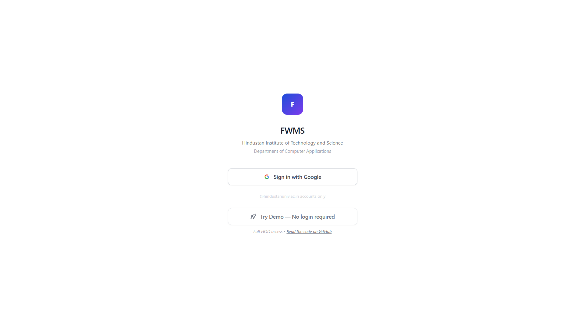
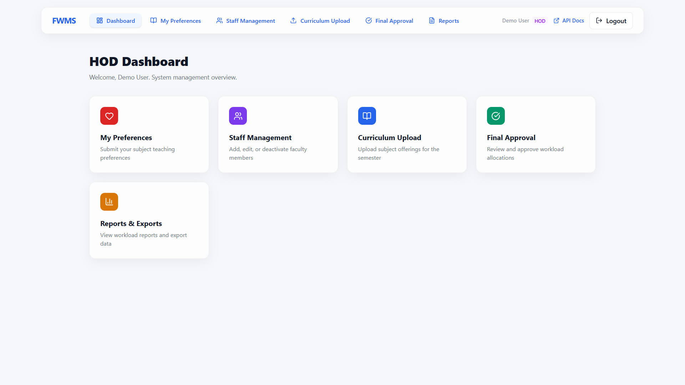
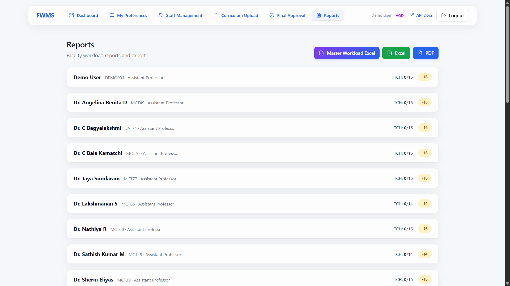
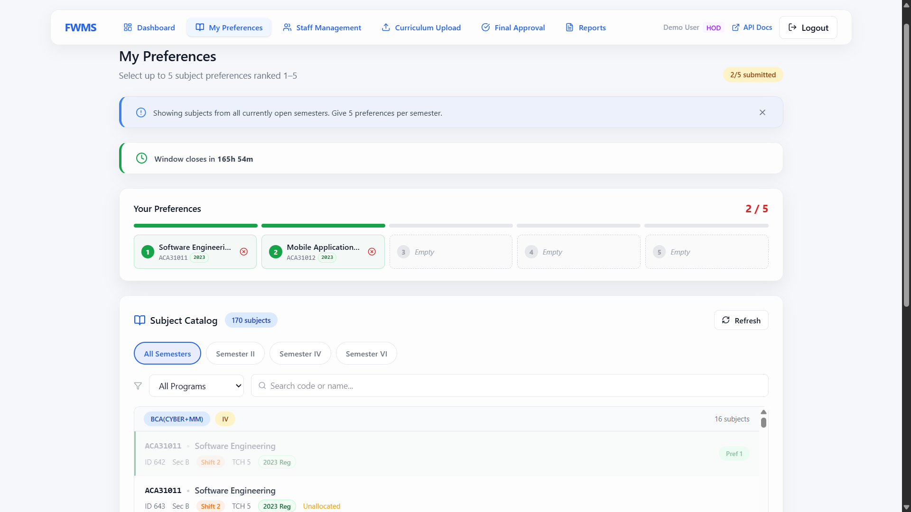

# Faculty Workload Management System (FWMS)

A FastAPI, React and PostgreSQL system for faculty subject preferences,
semester/cycle administration, workload allocation and reporting. The repository
contains two distinct operating contexts: an institutional configuration on
`main` and an isolated synthetic recruiter demo on `feature/recruiter-demo`.
Neither is presented here as evidence of institutional adoption or production
readiness.

[](https://fwms-workload-system.vercel.app)
[](https://fastapi.tiangolo.com)
[](https://react.dev)
[](https://neon.tech)

## Hosted paths and current status

| | |
|---|---|
| **Institutional frontend** | https://fwms-workload-system.vercel.app — Vercel reports `main` commit `8780324` |
| **Institutional backend** | https://fwms-workload-system.onrender.com — Render reports commit `8780324` live |
| **Recruiter-demo backend** | https://fwms-workload-system-1.onrender.com — isolated synthetic data, Render reports `15fdeb3` live |
| **Recruiter-demo frontend** | https://fwms-recruiter-demo.vercel.app — separate Vercel project; release artifact from `0c5f639` |
| **Recruiter-demo login** | Role-selected synthetic login; Google OAuth is disabled in demo mode |

The recruiter demo is separate from the institutional path. Its Render service
tracks `feature/recruiter-demo` and automatic commit deployment is enabled. The
frontend release was uploaded as a reviewed static artifact, without pushing that
branch, so it uses only the dedicated synthetic backend. See the [demo handoff]
(docs/FWMS_RECRUITER_DEMO_HANDOFF.md) for the release evidence and remaining
limitations.

---

## ✨ Features

- **Institutional Google OAuth** for configured university staff; deliberately blocked in recruiter-demo mode
- **Three enforced roles** — faculty, timetable coordinator and HOD; there is no separately enforced Admin role
- 📋 **Subject preference system** — faculty rank preferences (1–5)
- 📊 **Workload allocation** with teaching norm enforcement:
  Professor 12h · Associate Professor 14h · Assistant Professor 16h
- 📤 **Excel export** of finalized semester workload reports
- 🔄 **Multi-semester cycle** management (Odd / Even switching)
- 🏫 **Multi-shift, multi-section, multi-department** support
- ⏳ **Cold start detection** — login page auto-detects backend wake-up

---

## 📸 Screenshots

> 💡 **Demo availability:** The synthetic demo is a separately configured deployment. An institutional build only offers a demo redirect when its dedicated demo URL is configured; it never posts demo-login requests to the institutional API. See the [demo handoff](docs/FWMS_RECRUITER_DEMO_HANDOFF.md) for operator verification requirements.

| Login Page | HOD Dashboard |
|---|---|
|  |  |

| Workload Allocation | Subject Preferences |
|---|---|
|  |  |

---

## 📊 Analytics Dashboard (Power BI)

- 🖥️ **3-page interactive dashboard** built on top of the FWMS workload data
- 1️⃣ **Page 1 — Faculty Workload Overview**: KPI cards, overload distribution, faculty-level detail table
- 2️⃣ **Page 2 — Department Summary**: designation-wise workload comparison, deviation analysis
- 3️⃣ **Page 3 — Program Analysis**: UG vs PG workload split, program-level teaching hour distribution
- 🧮 **Built using DAX measures**, custom KPI cards, and cross-page navigation
- 🗄️ **Data sourced** from the FWMS Neon PostgreSQL database via CSV export

> 📸 **Dashboard screenshots below**
> *(to be added)*

---

## 🛠 Tech Stack

| Layer | Technology |
|---|---|
| Frontend | React 19 + TypeScript + Vite 7 |
| Backend | FastAPI + SQLAlchemy + Uvicorn (Python 3.12 used by the latest repair run) |
| Database | PostgreSQL; the recruiter demo uses a dedicated isolated Neon database |
| Auth | Google OAuth 2.0 + JWT (HS256) |
| Containerization | Docker + Docker Compose |
| Frontend Hosting | Vercel (auto-deploy from main) |
| Backend Hosting | Render (Docker, free tier) |
| Schema Management | Raw SQL migrations plus SQLAlchemy access; startup no longer replays SQL |

---

## 🚀 Local Development

```powershell
# Clone
git clone https://github.com/Nithish-kumar-git/fwms-workload-system
cd fwms-workload-system

# Backend (use only an isolated development database)
Copy-Item .env.example .env
docker compose up --build
# API at http://localhost:8000 | Docs at http://localhost:8000/docs

# Frontend (separate terminal)
cd frontend
npm ci
npm run dev
# App at http://localhost:5173
```

See [docs/DOCKER.md](docs/DOCKER.md) and [docs/OAUTH_SETUP.md](docs/OAUTH_SETUP.md).

---

## 📁 Project Structure

```
fwms-workload-system/
 ├── app/                   # FastAPI backend
 │   ├── auth/              # Google OAuth + JWT
 │   ├── core/              # Config, DB, middleware
 │   └── routers/           # API route handlers
 ├── frontend/src/          # React + TypeScript
 │   ├── api/               # Axios API client
 │   ├── components/        # Reusable UI components
 │   └── pages/             # Page components
 ├── migrations/            # 39 SQL schema files (001–039)
 ├── docs/                  # Setup guides
 ├── Dockerfile
 ├── docker-compose.yml
 └── startup.sh             # Starts API only; no migrations or seeds
```

---

## Focused verification

```bash
python -B tests/verify_security_repairs.py -v
python -B tests/verify_allocation_postgres.py -v
python -B demo/verify_offline.py -v
python -B demo/test_deployment.py -v
```

The latest repair record reports 24 focused offline tests, 12 demo launcher tests
and 10 isolated PostgreSQL 18.1 checks passing. Those are recorded results from the
repair run, not tests rerun for this documentation closeout. PostgreSQL behavior was
verified in a disposable loopback cluster. Docker builds/full Compose and hosted
browser workflows remain unverified.

---

## 🔑 Key Environment Variables

| Variable | Description |
|---|---|
| `DATABASE_URL` | PostgreSQL connection string |
| `SECRET_KEY` | JWT signing secret |
| `GOOGLE_CLIENT_ID` | OAuth client ID |
| `FRONTEND_URL` | Allowed CORS origin |
| `VITE_API_URL` | Backend URL (set in Vercel dashboard) |
| `FWMS_DEMO_MODE` | Enables fail-closed recruiter-demo isolation |
| `FWMS_DEMO_DATABASE_URL` | Recruiter-demo database connection |
| `FWMS_DEMO_SECRET_KEY` | Recruiter-demo signing key |
| `FWMS_DEMO_FRONTEND_URL` | Exact recruiter-demo frontend origin |
| `VITE_FWMS_DEMO_MODE` | Enables recruiter-demo UI/build boundary |

Full list in `.env.example`.

---

## Allocation workflow and limitations

Faculty rank subject preferences during an open window. Coordinators/HOD operate
semester and cycle state, run programme-filtered or full allocation, review or
override assignments, and the HOD can approve/freeze a finalized workload. A
programme-filtered run does not by itself finalize a multi-programme semester;
an explicit full run completes the cycle. Allocation is rules-based and does not
prove optimality or fairness. The shared advisory-lock repair only protects writers
running the repaired version; old instances and direct SQL writers do not
participate.

## Security and release blockers

- Retain the complete assessment in [docs/SECURITY_CONTAINMENT.md](docs/SECURITY_CONTAINMENT.md) and the historical incident record in `SECURITY_BREACH_REPORT.md`.
- Public Git history and current `main` contain an embedded Railway PostgreSQL credential candidate. The feature tip removes it, but rotation/revocation and provider-log review still require the credential owner. Do not test the old value.
- The institutional Render service remains on `main` commit `8780324`; that deployed startup logs its database URL and replays migrations/seeds. The guarded no-migration launcher exists only in the unpublished repair commits.
- Credential rotation, provider-log review, session invalidation and any history rewrite remain separate explicitly approved operations.
- External review of the allocation critical path, deployed-schema confirmation, Docker/Compose verification and hosted browser/permission checks remain required before rollout.
- Do not claim the local repair commits are pushed or deployed.

See [docs/FWMS_RECRUITER_DEMO_HANDOFF.md](docs/FWMS_RECRUITER_DEMO_HANDOFF.md) for the exact Git, test and deployment handoff.

